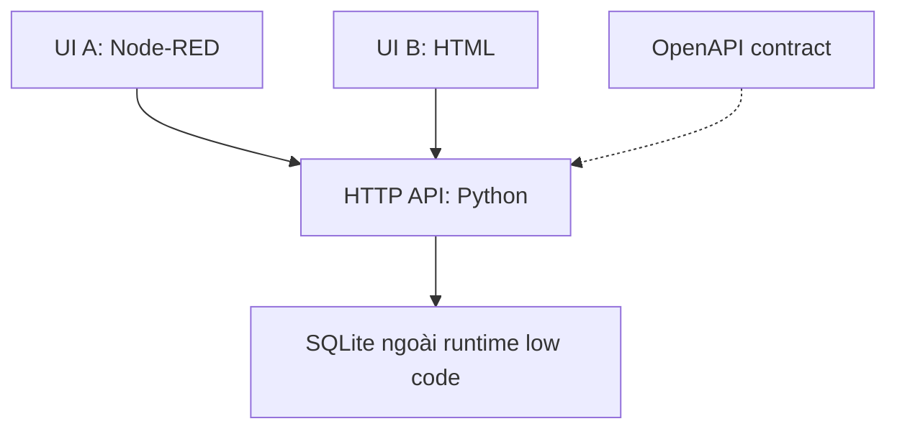

# Demo 1: API first và thay giao diện low code

Seminar **Low code and no code development: Vendor lock in low code**.
Sinh viên trình bày: **Trương Nguyễn Thùy Anh**.

Mục tiêu: dừng UI low code mà dữ liệu và nghiệp vụ vẫn hoạt động. Đây là demo giáo dục tự xây dựng, không phải một sản phẩm production hay phép đo thị trường.

## Kiến trúc



UI A gồm các node `http in`, `template`, `function`, `http request`, `http response`. Có một đoạn HTML nhỏ trong Template và Function chỉ cấu hình địa chỉ API. Đây là low code, không tuyên bố toàn bộ ứng dụng là no code. Python API giữ quy tắc title và cấp ID ổn định, cả hai UI cùng dùng quy tắc này. UI B được API phục vụ trực tiếp, không phụ thuộc Node-RED.

## Cách chạy với Docker

Cần Docker Engine và Docker Compose plugin, trình duyệt, Python 3.10 trở lên để chạy test. Từ Lubuntu, mở terminal ở thư mục dự án. Không cần tài khoản nền tảng trả phí.

```bash
git clone https://github.com/odixe06/lowcode-lockin-api-first-demo.git
cd lowcode-lockin-api-first-demo
docker compose up --build -d
```

Lần đầu cần mạng để tải image. Mở:

* Editor low code: http://127.0.0.1:1880
* UI A: http://127.0.0.1:1880/demo
* UI B: http://127.0.0.1:8000
* API contract: http://127.0.0.1:8000/openapi.json

Các port chỉ bind localhost. Node-RED editor chưa cấu hình authentication, chỉ dùng cho demo trên máy cá nhân. Không mở port ra Internet. Flow A mount chỉ đọc để tái lập, xem và export được nhưng thay đổi Deploy không được lưu vào file nguồn. Muốn chỉnh flow: export từ editor, cập nhật file `nodered/flows.json`, rồi restart container.

## Kịch bản trình bày khoảng 4 phút

1. Mở UI A, tạo yêu cầu `Máy in phòng học gặp lỗi`, ghi lại ID.
2. Mở UI B. Kiểm tra đúng title, ID và trạng thái `open`.
3. Chạy `docker compose stop ui_a`. UI A ngừng truy cập được.
4. Tải lại UI B, tạo tiếp yêu cầu `Cần hỗ trợ Wi-Fi`. Bản ghi cũ còn nguyên.
5. Thử title chỉ có dấu cách từ API hoặc UI. API trả HTTP 400, chứng minh validation nằm ở backend.
6. Mở `/export` để xem JSON trung lập. Ghi số bản ghi và thời gian thao tác thực đo.

Kết luận quan sát được: thay UI không làm mất dữ liệu hoặc thay quy tắc title. Demo chưa chứng minh migration toàn bộ hệ thống giữa hai vendor.

## Chạy backend không cần Docker

```bash
python3 api/server.py
```

Mở UI B tại http://127.0.0.1:8000. Để chạy UI A không dùng Docker, cần Node.js 18 trở lên và npm:

```bash
npm install --prefix .runtime node-red@4.1.0
API_URL=http://127.0.0.1:8000 ./.runtime/node_modules/.bin/node-red --userDir .runtime/user -p 1880 nodered/flows.json
```

Flow đã được nạp khi runtime khởi động. Editor lưu vào file nguồn trong cách chạy npm, nên commit thay đổi có chủ đích. Không commit thư mục `.runtime`.

## Kiểm thử

```bash
python3 -m unittest discover -p 'test_*.py' -v
```

Test kiểm tra validation, Unicode tiếng Việt, ID và nội dung giữ nguyên sau khi API restart, `/export` khớp dữ liệu và contract có thể đọc được. Kiểm tra tích hợp HTTP thật với Node-RED được mô tả trong [test report](docs/test-report.md).

## Lưu trữ và dừng demo

`docker compose stop` giữ dữ liệu. `docker compose down` gỡ container và network nhưng giữ named volume `ticket_data`. Không thêm `-v` nếu muốn giữ dữ liệu. JSON export chỉ bao gồm bảng tickets, không đại diện backup production có file đính kèm và phân quyền.

## Đánh đổi và phần phụ thuộc còn lại

* Flow JSON và Template vẫn mang cấu trúc của Node-RED.
* Backend, schema và OpenAPI vẫn cần người bảo trì.
* SQLite hợp lý cho demo nhỏ. Production có thể cần database server, authentication, authorization, TLS, migration schema và observability.
* API contract giảm công sức tích hợp, không tự chuyển UI hay workflow sang công cụ khác.

Nguồn: [Node-RED import/export](https://nodered.org/docs/user-guide/editor/workspace/import-export), [Node-RED Docker](https://nodered.org/docs/getting-started/docker), [OpenAPI Initiative](https://www.openapis.org/what-is-openapi).
